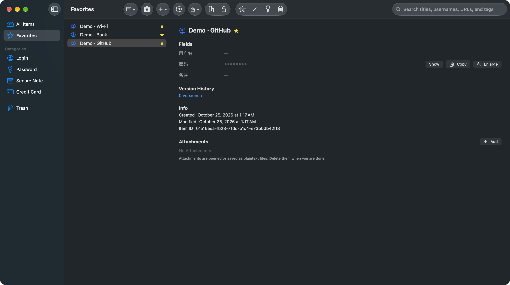
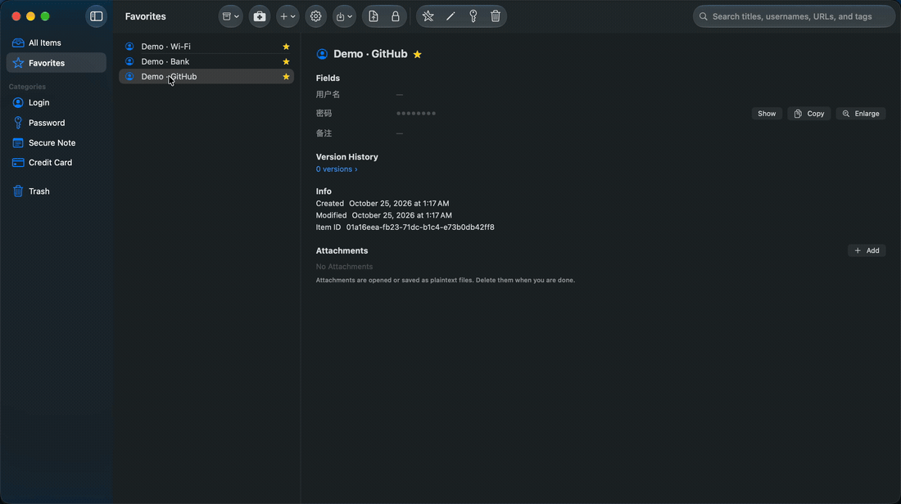
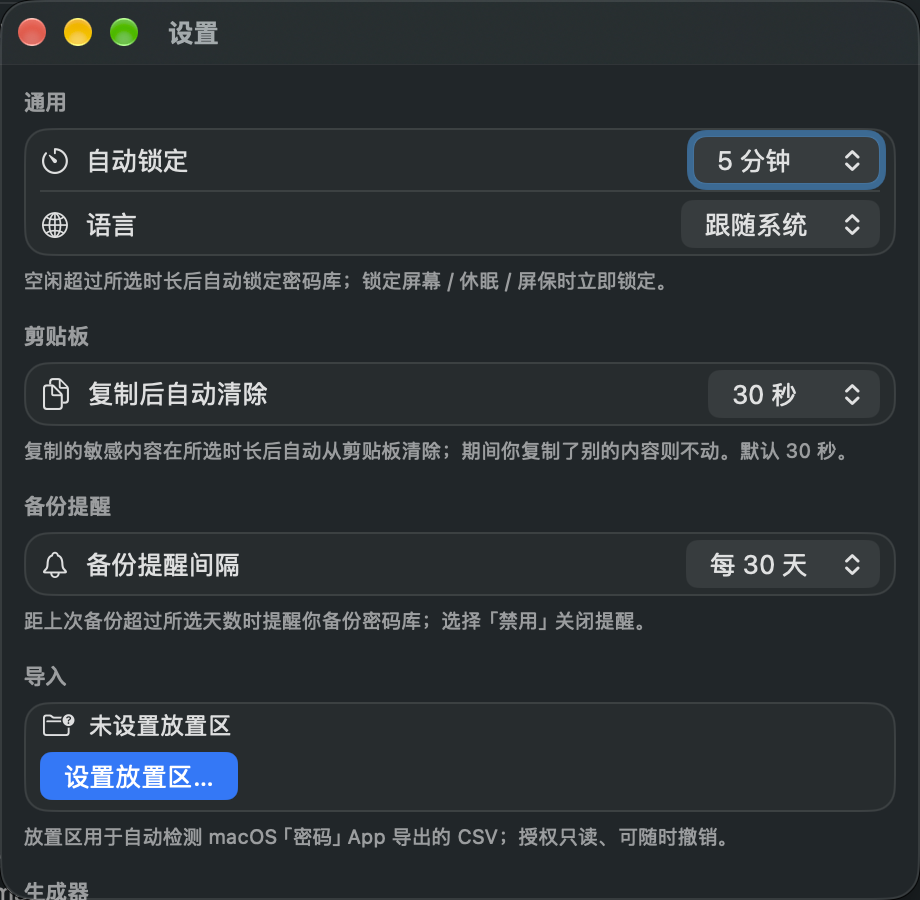
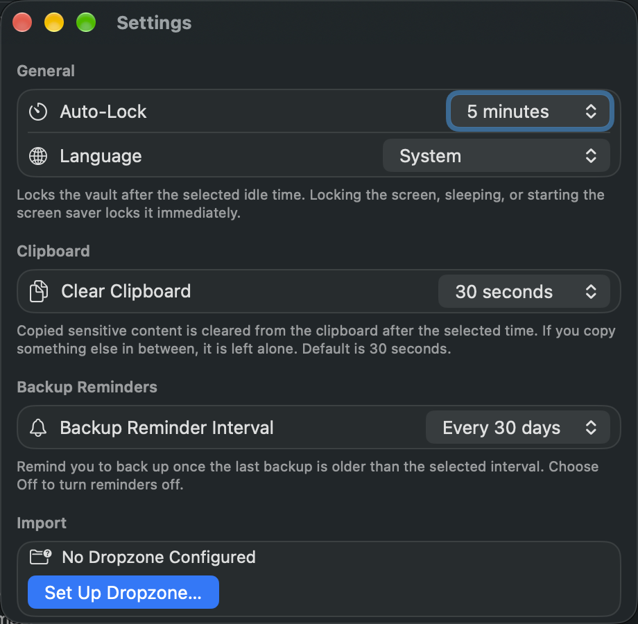

# Coffer

**A local-first password manager for macOS — your data never leaves the machine.**

[](LICENSE)

[](https://github.com/cygnusyang/coffer/releases/latest)
[](https://github.com/cygnusyang/coffer/releases)
[](https://github.com/cygnusyang/coffer/actions/workflows/rust.yml)

**English** · [中文](README.zh.md)

Coffer stores passwords, keys and credentials **only on your device** — no cloud sync, no account, no telemetry. The single network exception is the app update check (OTA), which is auditable: the Rust core's dependency graph has no network crates, and the app ships a self-verification page you can run yourself.

It also ships a local **MCP server** so AI coding tools (Claude Code, CodeBuddy, Codex, …) can pull secrets on demand — without the secret values ever entering the model context.

## Why Coffer

- **Verifiable "no cloud"** — not a promise in marketing copy: dependency graph + entitlements + OTA-only allowlist are all inspectable and asserted by tests.
- **Built for AI agents** — 4 read-only MCP tools; secret values are injected into a child process's environment via `run_with_secret`, never returned to the model.
- **Native macOS** — Rust core, SwiftUI front end, App Sandbox, Touch ID unlock, menu-bar resident, ⌥⌘P global hotkey.
- **No lock-in** — import 1PUX / CSV / opvault, export 1PUX-compatible / CSV, encrypted backup with a recovery path.
- **Open source** — AGPL-3.0; every version's design docs and acceptance criteria live in `docs/`.

## Screenshots





Settings (the UI ships in 简体中文 and English; switch under Settings → Language):

| 简体中文 | English |
| --- | --- |
|  |  |

> All items in the screenshots are demo data (Demo · GitHub / Demo · Bank / Demo · Wi-Fi) — no real credentials.

## Download

Grab the latest build from [Releases](https://github.com/cygnusyang/coffer/releases/latest):

- `Coffer-vX.Y.Z.dmg` — fresh install
- `Coffer-vX.Y.Z.zip` — used by the built-in OTA updater (don't unzip over the app manually)

> Builds are signed with an Apple Development certificate. Developer ID signing + notarization is **not yet in place**, so on first launch Gatekeeper may complain — right-click the app → **Open**. Building from source is equally supported (see below).

The table below is refreshed weekly by CI and counts **GitHub asset downloads** (cumulative, OTA updates included — not unique users).

<!-- downloads:start（auto-generated by tools/update_download_stats.py — do not edit） -->

<!-- downloads:end -->

## Features

| Area | What you get |
| --- | --- |
| Vault | Master password + Argon2id KDF, optional Touch ID unlock, offline recovery code, multiple vaults, auto-lock, clipboard auto-clear |
| Items | 22 item templates + custom fields, tags, history with rollback, search, trash |
| Secrets | TOTP (QR scan), character & passphrase generator, password strength gate |
| Portability | Import 1PUX / CSV / opvault, export 1PUX-compatible / CSV, encrypted backup & restore |
| AI tools | Read-only MCP server, one-click registration for Claude Code / CodeBuddy / Codex, copy-paste config for Gemini CLI / Cursor / VS Code / Windsurf / Zed |
| CLI | `coffer mcp`, `coffer set-password`, `coffer set-env` — values only via stdin, never argv or logs |
| Updates | Self-hosted OTA: Ed25519-signed manifest, SHA-256 verified zip, allowlisted hosts |

**Not included (by design):** browser extension (retired), passkey *creation/use* (view/import only — a degraded, documented mode), cloud sync.

## Architecture


Rust core (`core/`) owns crypto, storage and the MCP surface; SwiftUI (`macos/`) is the app shell; every secret-touching operation stays inside the core process. See [data flow](docs/assets/data-flow.svg) and [key hierarchy](docs/assets/key-hierarchy-overview.svg).

## Build from source

```bash
./tools/build_macos_app.sh      # output → macos/build/Coffer.app
open macos/build/Coffer.app     # drag into /Applications
```

Requires Rust ≥ 1.85 (pinned by `core/rust-toolchain.toml`) and a full Xcode toolchain. Local builds use a development signature; if Gatekeeper blocks the first launch, right-click → **Open**.

## First run

1. Create a vault and set a **master password**. There is no server and no backdoor. If you lose it: Touch ID unlock or an offline recovery code (both opt-in) can reset it — with neither enabled, the data is **permanently lost**.
2. Unlock and use it: 22 item templates, TOTP, password / passphrase generator.
3. Settings: auto-lock, clipboard clearing, menu-bar resident (⌥⌘P).

## MCP: let AI tools read secrets safely

Enable **Settings → MCP / Agent Collaboration → MCP unlock escrow** once (master password confirmation). The unlock key is stored in the macOS Keychain, so the CLI starts without a password and no password is written into any AI tool's config.

The same page has an **AI tools** list — one-click registration for **Claude Code / CodeBuddy / Codex** (independent switches with state read-back), and copy-paste commands for Gemini CLI / Cursor / VS Code / Windsurf / Zed.

Preferred path — install the Claude Code plugin (shipped in this repo):

```bash
claude plugin marketplace add cygnusyang/coffer
claude plugin install coffer@coffer
```

Manual registration instead:

```bash
claude mcp add coffer \
  -e COFFER_VAULT_DIR=/path/to/vault \
  -- "/Applications/Coffer.app/Contents/Helpers/coffer.app/Contents/MacOS/coffer" mcp --provider coffer
```

Registered agents get 4 tools: `list_secret_names`, `list_secrets`, `run_with_secret`, `get_secret_metadata`. The MCP surface is **read-only** — secret values are only passed into a child process environment by `run_with_secret`, never into the model context.

## CLI

The CLI ships inside the app bundle and **must be run from there** (signature is bound to the bundle):

```bash
alias coffer="/Applications/Coffer.app/Contents/Helpers/coffer.app/Contents/MacOS/coffer"
```

| Subcommand | Purpose |
| --- | --- |
| `coffer mcp` | Start the MCP server (read-only) |
| `coffer set-password` | Update an item's password (optionally `--user` to write login + password as a pair) |
| `coffer set-env` | Write an environment container |

Exit codes: `0` success · `1` unlock failed (fail-closed) · `2` target missing/ambiguous · `3` password too weak · `4` usage error.

## Testing

```bash
cd core && cargo test --workspace --no-fail-fast
```

## Documentation

Design docs, acceptance criteria and decision records live in `docs/` (written in Chinese) — start with the **[documentation index](docs/README.md)**, which maps the corpus and lists the five documents worth reading first. macOS specifics: [macos/README.md](macos/README.md).

## License

[AGPL-3.0](LICENSE). Copyright (c) 2026 Coffer contributors.

- [PRIVACY.md](PRIVACY.md) · [TRIAGE.md](TRIAGE.md)
