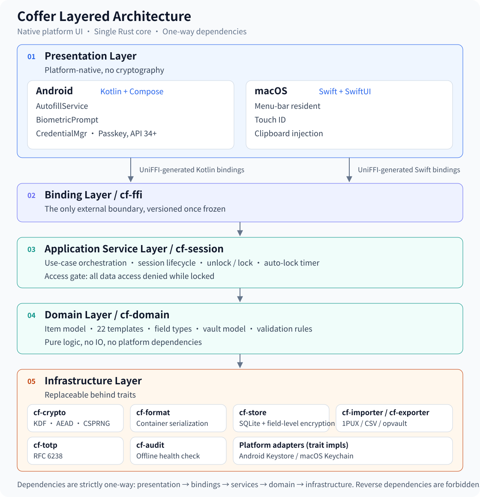

# Coffer

[](LICENSE)

[](https://github.com/cygnusyang/coffer/releases/latest)
[](https://github.com/cygnusyang/coffer/releases)

**中文** · [English](README.en.md)

**数据不出本机的密码管理器**：密码、密钥、凭据只存本地，不上传云端（仅软件更新 OTA 联网；可审计验证，NFR-SEC-07）。另提供本机 MCP 服务器，供 Claude Code、Codex 等本地大模型工具按需取密——数据同样不出本机。

- 仓库：<https://github.com/cygnusyang/coffer> · 许可证：AGPL-3.0

## 下载

安装包见 [Releases](https://github.com/cygnusyang/coffer/releases/latest)：`Coffer-vX.Y.Z.dmg`（新装）、`Coffer-vX.Y.Z.zip`（OTA 自动更新使用，勿手工解压覆盖）。

下表由 CI 每周自动刷新（`tools/update_download_stats.py`）。口径是 **GitHub 资产累计下载次数**，含 OTA 自动更新，不等于去重用户数。

<!-- downloads:start（由 tools/update_download_stats.py 自动生成，勿手改） -->

_最后更新：2026-10-24（来源：GitHub Release 资产累计下载次数，含 OTA 自动更新）_

| 版本 | 发布时间 | DMG（新装） | ZIP（OTA 更新） | 合计 |
| --- | --- | ---: | ---: | ---: |
| v2.12.0 | 2026-10-22 | 1 | 1 | 2 |
| v2.11.0 | 2026-10-18 | 0 | 4 | 4 |
| **总计** | — | **1** | **5** | **6** |

<!-- downloads:end -->

## 架构



Rust 核心（`core/`）负责加密、存储与 MCP 面；SwiftUI（`macos/`）是 App 外壳；所有触碰密钥的操作都留在核心进程内。另见[数据流](docs/assets/data-flow.svg)、[密钥层级](docs/assets/key-hierarchy-overview.svg)。

## 快速开始

### 构建 App（macOS）

```bash
./tools/build_macos_app.sh      # 产物 → macos/build/Coffer.app
open macos/build/Coffer.app     # 建议拖入 /Applications
```

要求 Rust >= 1.85（由 `core/rust-toolchain.toml` 固定）。本地构建为开发签名，首次启动若被 Gatekeeper 拦截：右键 App → 「打开」。

### 首次启动与建库

1. 创建密码库并设置**主密码**——无服务端、无恢复后门；主密码遗失时，已启用 Touch ID 解锁或已生成离线恢复码的用户可凭生物识别 / 恢复码重设主密码（FR-17），两者均未启用则**遗失 = 数据永久丢失**
2. 解锁后即可使用：**22 类条目模板** + 自定义字段、**TOTP 验证码**、随机字符 / 密码短语**双模式生成器**
3. 「设置」页：自动锁定、剪贴板自动清除、菜单栏常驻（全局快捷键 ⌥⌘P）

### 导入 / 导出 / 备份

| 方向 | 格式 | 说明 |
| --- | --- | --- |
| 导入 | 1PUX / CSV / opvault | 字段映射逐项可核对，未知字段不静默丢弃 |
| 导出 | 1PUX 兼容 / CSV | CSV 为明文，导出前双重确认 |
| 备份 | 加密备份 / 恢复 | 改主密码不重加密全库 |

### 浏览器自动填充（独立插件仓库）—— 已废弃

> **废弃注记（2026-10-09）**：浏览器扩展**整体废弃**（用户裁定，扩展连商城上架都不要），App 侧集成已移除，不再提供克隆 / 构建 / 配对操作说明。扩展源码仓库保留：**[coffer-browser-extension](https://github.com/cygnusyang/coffer-browser-extension)**（其 README 已标废弃），供历史查阅。

### 与 AI 工具协同（MCP）

先在 App「设置 → MCP / Agent 协作」启用「MCP 解锁托管」（需输入主密码确认）：解锁密钥存入本机钥匙串，之后 CLI 可**免密码**启动，注册命令无需写入密码。

同一页的「AI 工具」可直接为 **Claude Code / CodeBuddy / Codex** 一键注册（各带独立开关与状态回读），Gemini CLI / Cursor / VS Code / Windsurf / Zed 提供一键复制命令。以下以 Claude Code 为例。

推荐：安装 Claude Code 插件（随主仓分发）。插件在连接时自动探测 App 二进制与本机 vault，无需写路径：

```bash
claude plugin marketplace add cygnusyang/coffer
claude plugin install coffer@coffer
```

不用插件时的手动注册：

```bash
# 注册到 Claude Code（免密；前置 = 设置 → MCP / Agent 协作 → 启用「MCP 解锁托管」）
claude mcp add coffer \
  -e COFFER_VAULT_DIR=/path/to/vault \
  -- "/Applications/Coffer.app/Contents/Helpers/coffer.app/Contents/MacOS/coffer" mcp --provider coffer
```

> 已安装插件时无需再执行本步——同名 `coffer` 条目并存时来源优先级不直观。

> 未启用托管时，可追加 `-e COFFER_VAULT_PASSWORD=...` 用环境变量兜底——但密码会**明文写入** Claude Code 配置文件，建议优先启用托管。

注册后 Agent 可调用 4 个工具：`list_secret_names` / `list_secrets` / `run_with_secret` / `get_secret_metadata`。MCP 保持只读（无写工具）：密码值只经 `run_with_secret` 注入子进程环境变量，不进入 Agent 模型上下文。

coffer 必须从 App 内路径运行（见下节「构建与路径」）。

## 命令行（CLI）使用

CLI 面向脚本化的写操作：更新条目密码、写入环境容器。MCP 读面见上节「与 AI 工具协同」。

### 构建与路径

CLI 随 App 分发，**必须从 App 内路径运行**——拷贝到别处单独运行会被系统终止（签名校验绑定 App 包）。假设 App 装在 `/Applications`：

```bash
alias coffer="/Applications/Coffer.app/Contents/Helpers/coffer.app/Contents/MacOS/coffer"
```

源码构建（开发 / CI；此形态**读不到钥匙串托管**，解锁只能走环境变量兜底）：

```bash
cd core && cargo build --release -p cf-mcp    # 产物：core/target/release/coffer
```

### 解锁凭据

- `COFFER_VAULT_DIR`（**必填**）：密码库目录路径。
- 取密顺序：**MCP 解锁托管（钥匙串，推荐）→ `COFFER_VAULT_PASSWORD` 兜底 → 都无则退出 1**；环境变量不覆盖托管，仅未启用托管时兜底。
- 托管在 App「设置 → MCP / Agent 协作」启用；换主密码不影响托管（吊销 = 在设置页关闭托管开关）。
- 密码 / 敏感值只走 stdin（终端隐藏或管道），不落命令行、进程列表或日志。

### 子命令一览

| 子命令 | 用途 | 版本 |
| --- | --- | --- |
| `mcp` | 启动 MCP 服务器（只读，见上节） | v2.0.0+ |
| `set-password` | 更新条目密码（可选 `--user` 用户名一对写） | v2.5.0+（`--user` v2.5.2+） |
| `set-env` | 写入环境容器 | v2.8.0+ |

### 更新密码 —— `coffer set-password`

```bash
coffer set-password "GitHub"                          # 密码从终端隐藏输入
coffer set-password "GitHub" --user cygnusyang        # 用户名 + 密码一对写
coffer set-password --id <条目UUID>                   # 按 UUID 定位（名称歧义时）
coffer set-password --force "GitHub"                  # 绕过强度门禁（慎用）
```

- 密码只走 stdin（终端隐藏或管道读一行），不进命令行 / 进程列表 / 日志；用户名可走命令行。
- 强度不达标默认拒绝（`--force` 绕过）；成功自动追加历史，App 内可回滚。
- 成功提示：`已更新 GitHub（cygnusyang） · 旧版本可在 App 历史中回滚`。

### 写环境容器 —— `coffer set-env`

```bash
coffer set-env --scope my-app API_KEY=xxx LOG_LEVEL=debug   # 内联写入（非敏感值）
coffer set-env --scope my-app GITHUB_TOKEN                   # 裸变量名 → 值从终端隐藏输入
coffer set-env --scope my-app --unset OLD_KEY                # 删除变量（幂等）
coffer set-env --id <容器UUID> NAME=VALUE                    # 按 UUID 定位
```

- 环境容器是带 `coffer:environment` 标签的安全笔记条目；首次写入自动创建容器。
- 内联可一次写多个 `NAME=VALUE`（值可含 `=`）；**至多一个裸变量名**（其值从 stdin 读取）。
- `NAME=`（等号后空）为置空串，不是删除；删除用 `--unset`。
- 值不落 stdout / 日志（成功消息只列变量名与容器名）。

### 环境变量（用户相关）

| 变量 | 用途 | 必填 |
| --- | --- | --- |
| `COFFER_VAULT_DIR` | 密码库目录路径 | 是 |
| `COFFER_VAULT_PASSWORD` | 兜底解锁密码（仅未启用托管时） | 否 |

### 退出码

`set-password` / `set-env` 共用：

| 码 | 语义 |
| --- | --- |
| 0 | 成功（set-env 首次写入自动建容器） |
| 1 | 解锁失败 fail-closed（托管不可用或托管解锁失败，不回落 env） |
| 2 | 目标未命中 / 歧义 / 非目标类型 |
| 3 | set-password 强度不足；set-env 保留槽位不适用 |
| 4 | 参数 / 用法错误 |

## 测试

```bash
cd core && cargo test --workspace --no-fail-fast
```

## 文档

完整分类与文件索引见 [文档导航](docs/README.md)。常用入口：[需求与架构](docs/01-需求与架构/)、[研发计划与决策](docs/02-研发计划与决策/)、[功能设计](docs/03-功能设计/)、[测试与验收](docs/04-测试与验收/)；macOS 侧说明见 [macos/README.md](macos/README.md)。

## 许可证

[AGPL-3.0](LICENSE)（GNU Affero General Public License v3.0）。Copyright (c) 2026 Coffer contributors。

> 修订注记：本文按 [docs/00-文档风格指南.md](docs/00-文档风格指南.md) 于 2026-10-16 重构（仅风格转换：术语统一「MCP 服务器」、删冗余、修订注记；命令、版本、退出码、废弃注记等事实不变）。
> 修订注记（2026-10-17）：「首次启动与建库」主密码表述事实修正——补 Touch ID 解锁 / 离线恢复码重设路径（FR-17，均 opt-in），删除「唯一解锁凭据 / 遗失不可恢复」绝对化表述（与 v2.5.0 已实现恢复通道矛盾；doc-reviewer NOTE-3 核销）。
> 修订注记（2026-10-18）：Claude Code 插件自独立仓 coffer-claude 收编入主仓 `plugins/claude-code/`（根级 `.claude-plugin/marketplace.json` 提供市场清单，许可随主仓 AGPL-3.0）；「与 AI 工具协同（MCP）」节新增插件安装为推荐路径，原手动 `claude mcp add` 注册降级为不用插件时的兜底。同日独立仓 coffer-claude 标记废弃（README 顶部注记指向本仓），插件唯一安装入口 = 本仓市场。
