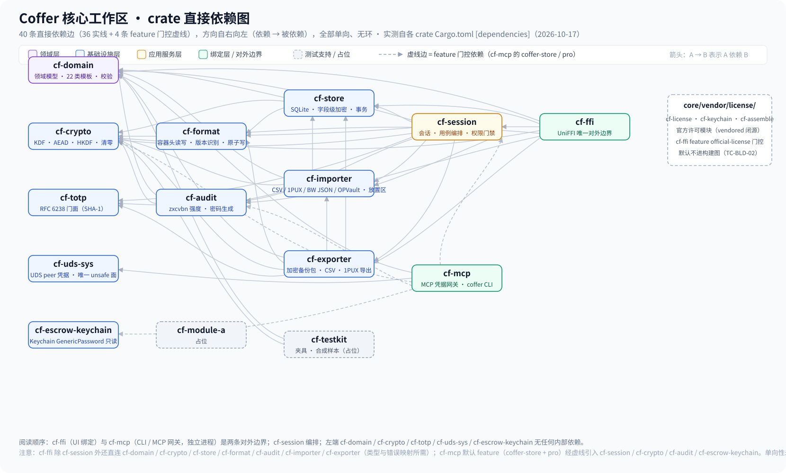
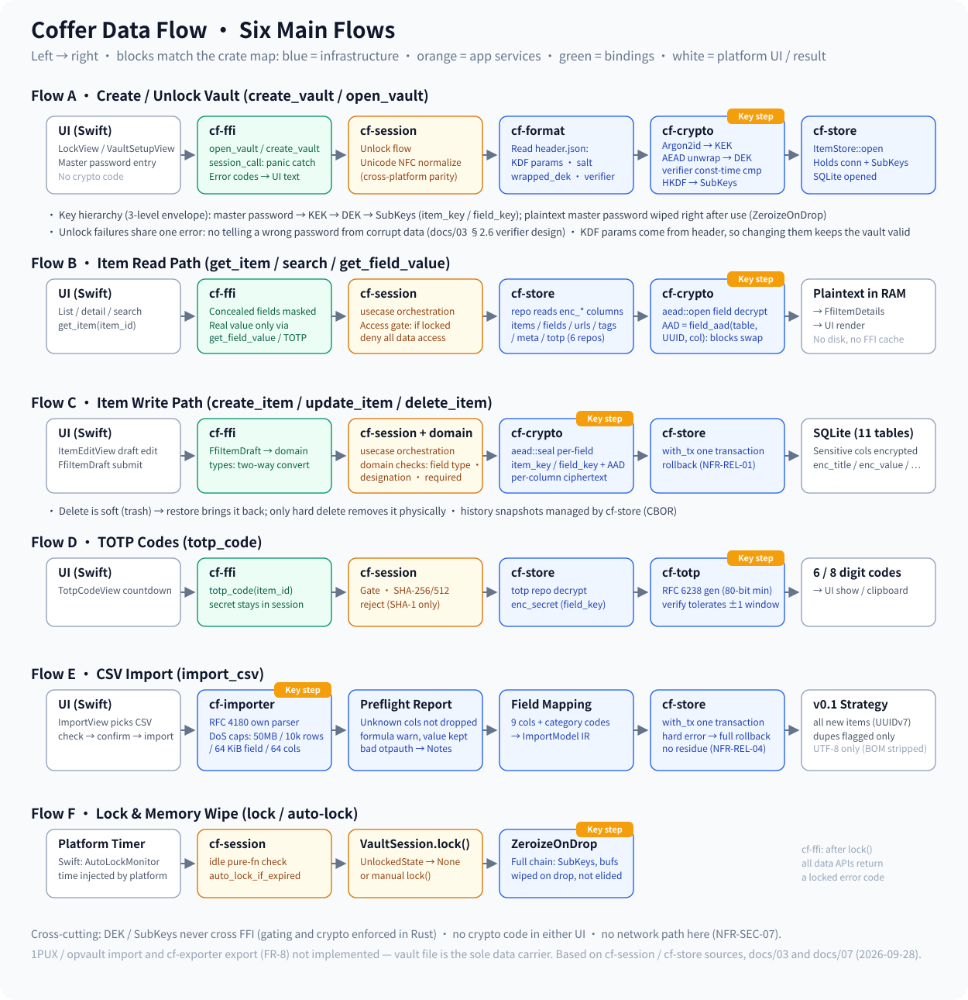

# 11 · 架构总览与模块设计

> 本文基于**当前代码**（2026-10-17，`run_gate.sh` 门禁全绿的 v2.10.3 已发版状态；v2.11.0 MCP 一键注册在途）梳理项目整体架构、模块划分与数据流，供团队成员理解系统全貌与后续维护使用。
>
> 与既有设计文档的关系：`02-概要设计` 定分层、`03-详细设计` 定规格、`04-系统设计` 定工程方法——本文不替代它们，而是把**代码实际长成的样子**汇总成一页入口。实现与设计的已知偏差集中在 §3.4，一律如实标注、不粉饰。

---

## 1. 一句话架构

**平台原生 UI（Swift / Kotlin）＋ 单一 Rust 内核，单向依赖，零外部网络。**

加密、存储、业务逻辑全部在 Rust 核心（`core/` 下 15 个成员 crate）；两端 UI 不含任何密码学代码；全仓库不存在外部网络代码路径（NFR-SEC-07，`tools/check_no_network.sh` 对依赖树静态核查；本机内进程间通信 UDS / 本机回环允许且不违背承诺，docs/02-研发计划与决策/03-不可逆决策追认表.md D-4）。两端永不直连，无同步机制（单机架构的排除项，非缺陷）。

对外边界有**两条**：cf-ffi（UniFFI，供 UI 绑定）与 cf-mcp（lib + `coffer` CLI，MCP Agent 凭据网关，stdio / UDS 本机传输）。官方许可模块（`core/vendor/license/`，闭源 vendored）经 feature 门控，默认不进公开构建图。

---

## 2. 工程结构与目录组织

```
coffer/
├── core/                  # Rust 工作区（cargo workspace，15 个成员 crate + vendor）
│   ├── Cargo.toml         # workspace 清单：成员、依赖版本、release profile（panic=unwind）
│   ├── cf-crypto/         # 基础设施层：加密原语封装（含 opvault / AES-GCM 恢复码封装）
│   ├── cf-format/         # 基础设施层：容器格式读写
│   ├── cf-store/          # 基础设施层：SQLite 存储引擎
│   ├── cf-domain/         # 领域层：领域模型（无 IO、无加密）
│   ├── cf-importer/       # 基础设施层：CSV / 1PUX / Bitwarden JSON / OPVault 导入 + 放置区
│   ├── cf-exporter/       # 基础设施层：加密备份包 / CSV / 1PUX 导出
│   ├── cf-totp/           # 基础设施层：TOTP 门面
│   ├── cf-audit/          # 基础设施层：离线安全检查
│   ├── cf-session/        # 应用服务层：会话与用例编排
│   ├── cf-ffi/            # 绑定层：UniFFI 对外边界（UI 侧）
│   ├── cf-mcp/            # 绑定层/网关：MCP Agent 凭据网关 + coffer CLI
│   ├── cf-uds-sys/        # 基础设施层：UDS peer 凭据 syscall（唯一 unsafe 面）
│   ├── cf-escrow-keychain/# 基础设施层：Keychain GenericPassword 只读封装（MCP escrow）
│   ├── cf-module-a/       # 占位（无依赖、无接口）
│   ├── cf-testkit/        # 占位：夹具与合成样本
│   └── vendor/license/    # 官方许可模块（cf-license / cf-keychain / cf-assemble，闭源 vendored，
│                          #   公开仓仅 stub，feature official-license 门控，默认不进构建图）
├── macos/                 # macOS 端：Swift + SwiftUI（swiftc 直编，无 Xcode 工程）
│   ├── Coffer/
│   │   ├── AppModel.swift / AppPhase.swift   # 应用状态与阶段
│   │   ├── CoreBindings/          # cf_ffi.swift 等 UniFFI 生成绑定
│   │   ├── Platform/              # AutoLockMonitor · Clipboard · BiometricKeychain · HotKeyMonitor
│   │   │                          #   · McpEscrowKeychain · StatusItemController（菜单栏）
│   │   ├── Views/                 # ~50 个页面：Lock / Main / ItemDetail / ItemEdit / 导入向导×4 /
│   │   │                          #   DropzoneImport / McpSettings / Settings / Trash / HealthCheck /
│   │   │                          #   AuditLog / UpdateSheet / 恢复码 / 改密 / Onboarding 等
│   │   ├── Dropzone/              # 放置区：security-scoped bookmark · 目录监视 · 指纹去重 · 导入状态机
│   │   ├── McpRegisterHelper/     # CofferMcpHelper.app 源码（构建时装配为嵌套 Helper，沙盒外写 ~/.claude.json）
│   │   ├── Updater/               # OTA：UpdaterManager · 安装器 · 清单验签 · SecCode 校验
│   │   ├── Support/               # McpRegistrar · DeleteVaultPolicy · OfficialLicenseService ·
│   │   │                          #   TouchID 三件套 · 诊断 · 恢复码验证 · 菜单栏文案
│   │   └── Pro/                   # EnvironmentContainer（环境容器）
│   └── Tests/                     # 28 个自研测试可执行（main.swift 直编，非 XCTest）
├── android/               # Android 端（M5，未开始，仅规划 README）
├── docs/                  # 01-需求与架构 · 02-研发计划与决策 · 03-功能设计 · 04-测试与验收 ·
│                          #   05-技术研究 · 06-交接记录 + archive/ + assets/
├── tools/                 # 55 个脚本：build_macos_app.sh · run_gate.sh · run_ui_gate.sh（L1/L2/L3/MCP）·
│                          #   check_no_network.sh · check_ota_whitelist.sh · bootstrap_official_license.sh 等
└── tests/                 # 跨端一致性比对样本（1PUX / CSV，仅合成数据）
```

**crate 分层归属**（与 `core/Cargo.toml` 的成员注释一致）：

| 层 | crate | 实现状态 |
| --- | --- | --- |
| 基础设施层 | cf-crypto · cf-format · cf-store · cf-importer · cf-totp · cf-audit · cf-uds-sys · cf-escrow-keychain | ✅（cf-importer 的 KDBX 仅读取冒烟测试，实现推后） |
| 基础设施层 | cf-exporter | ✅ v0.2 交付（FR-8：加密备份包 / CSV / 1PUX） |
| 领域层 | cf-domain | ✅ |
| 应用服务层 | cf-session | ✅ |
| 绑定层 | cf-ffi | ✅ |
| 绑定层 / 网关 | cf-mcp | ✅（lib + `coffer` CLI 二进制） |
| 测试支持 | cf-testkit | ⬜ 占位（M1 计划内） |
| 占位 | cf-module-a | ⬜ 占位 |

占位 crate 刻意只保留 lib.rs 意图声明、不含假接口——宁可目录是空的，也不要 `todo!()` 占位。

---

## 3. 系统架构总览

### 3.1 分层视图

五层职责与边界见 `docs/assets/layered-architecture.svg`（既有图，仍然有效）：

**表示层 → 绑定层（cf-ffi）→ 应用服务层（cf-session）→ 领域层（cf-domain）→ 基础设施层（cf-crypto / cf-format / cf-store / …）**，禁止反向依赖。

### 3.2 crate 依赖图（代码实测）



上图 **40 条直接依赖边**（36 实线 + 4 条 cf-mcp 的 feature 门控虚线）全部实测自各 crate 的 `[dependencies]` 段（不含 dev-dependencies），方向自右向左、全部单向、无环。直接依赖明细：

| crate | 直接依赖 |
| --- | --- |
| cf-crypto / cf-totp / cf-domain / cf-uds-sys / cf-escrow-keychain | （无内部依赖） |
| cf-format | cf-crypto |
| cf-store | cf-crypto · cf-format · cf-domain |
| cf-audit | cf-domain · cf-crypto |
| cf-exporter | cf-domain · cf-format · cf-crypto · cf-store · cf-importer · cf-totp |
| cf-importer | cf-domain · cf-crypto · cf-store · cf-totp |
| cf-session | cf-domain · cf-store · cf-format · cf-crypto · cf-totp · cf-audit · cf-importer · cf-exporter |
| cf-ffi | cf-session · cf-domain · cf-crypto · cf-store · cf-format · cf-audit · cf-importer · cf-exporter（feature `official-license` 下另挂 vendor 三 crate） |
| cf-mcp | 常规：cf-domain · cf-uds-sys；feature `coffer-store`（默认开）门控：cf-session · cf-crypto · cf-audit · cf-escrow-keychain |
| cf-testkit | cf-domain · cf-crypto |
| cf-module-a | （无，占位） |

### 3.3 依赖方向的硬约束（审计口径）

- **领域层不依赖基础设施**：cf-domain 的 `[dependencies]` 里没有任何 `cf-*` crate，无 IO、无加密、无平台依赖——可由 Cargo.toml 直接验证。
- **上层可横向引用下层，反向禁止**：任何下层 crate 引用上层即为架构违规，CI（建好后）与代码评审都按此口径把关。
- **DEK / SubKeys 永不跨 FFI**：任何对外接口签名（cf-ffi 与 cf-mcp 均是）不含密钥类型；会话门禁与加解密全部在 Rust 侧强制。
- **两端 UI 不含密码学代码**：macOS 侧只消费 cf-ffi 生成的绑定。
- **官方许可模块默认缺席**：vendor 三 crate 公开仓为空 stub，未经 `tools/bootstrap_official_license.sh` 覆盖 + `official-license` feature 编译时，二进制零许可符号（TC-BLD-02：自编译 = PermitAll 免费版）。

### 3.4 代码与「理想分层」的四处出入（如实记录）

1. **cf-ffi 除 cf-session 外还直连 7 个下层 crate**（cf-domain / cf-crypto / cf-store / cf-format / cf-audit / cf-importer / cf-exporter）。用途是类型映射（cf-ffi/src/types.rs）与错误映射（error.rs 对齐 docs/01-需求与架构/03-详细设计.md §12 错误码表）。**单向性未破坏**，但「绑定层只经 cf-session 说话」这句理想表述与实际不符。
2. **cf-session 直接依赖 cf-importer 与 cf-exporter**：CSV 导入的落库编排 `import_csv` 实际落在 cf-importer 内（经 `cf-store::ItemStore::with_tx` 单事务完成）；导出的格式实现同理落在 cf-exporter，cf-session 的 `export_gate` 只做门禁与编排。该偏差已在 cf-importer lib.rs「与设计文档的一处偏差」一节声明。
3. **cf-importer 依赖 cf-store 与 cf-totp**：导入器不是「叶子」基础设施——它承担单事务落库编排，并复用 TOTP URI 解析。把 cf-importer 理解为「导入用例的完整执行者」比「纯解析器」更准确。
4. **cf-mcp 是 UI 之外的第二条对外边界**：`coffer` CLI（`mcp` stdio/UDS 传输、`set-password` / `set-env`）不经 cf-ffi，默认 feature（`coffer-store` + `pro`）下经 cf-session 直接读写库；MVP 纯 cf-domain 路径则无 session 依赖。feature 门控依赖以虚线标注于依赖图。

> 处置口径：四处均不违反单向依赖硬约束，暂不改代码；若未来做依赖裁剪（如把类型映射收敛回 cf-session），需先改 docs/01-需求与架构/03-详细设计.md §5 再动代码（格式/接口变更纪律：先文档后代码）。

---

## 4. 核心模块设计

以下按依赖顺序自底向上。每个模块给：职责边界（管什么/不管什么）、关键能力、对上暴露的接口形态。

### 4.1 cf-crypto —— 加密原语封装层

| 项 | 内容 |
| --- | --- |
| **职责** | 密码学原语的安全封装：Argon2id KDF、XChaCha20-Poly1305 AEAD、HKDF 子密钥派生、CSPRNG、内存清零（Zeroize + ZeroizeOnDrop） |
| **不管什么** | 不知道任何业务概念——不知道「条目」「保险库」是什么；不自造密码学原语，只用成熟库高层 API |
| **关键能力** | `kdf`（Argon2id，参数可配置，docs/01-需求与架构/03-详细设计.md §2.3）；`aead::seal/open`（字段级加解密）；`build_field_aad(uuid, 列名)` / `build_table_field_aad(表, uuid, 列名)`（AAD 构造——密文与存储位置绑定，防挪列挪表）；`SubKeys::derive`（HKDF 派生 item_key / field_key）；`SessionKey`（内存清零的密钥类型）；opvault 解密模块（PBKDF2-HMAC-SHA512 + AES-256-CBC，docs/22/24）；`aes_gcm_seal/open`（FR-17.2 恢复码封装，AEAD 唯一入口收口） |
| **硬约束** | 密钥类型必须可清零；禁 `unwrap()/expect()`（编译期 deny）；错误显式不泄漏攻击者可用信息 |

### 4.2 cf-format —— 容器格式层

| 项 | 内容 |
| --- | --- |
| **职责** | 库容器的结构层：header.json 读写、格式版本识别、原子写入（atomic.rs）、完整性清单 |
| **不管什么** | 不管理条目内容（cf-store 的职责）；不做字段级加密——只读写**已是密文**的 BLOB；交换形态 `.lvvault`（ZIP）归 cf-exporter |
| **关键能力** | `open_container`（目录识别无魔数：header.json 存在且可解析且版本受支持）；KDF 参数 / salt / wrapped_dek / verifier 的承载；原子替换写（防半写损坏） |
| **纪律** | 格式变更必须先写进 docs/01-需求与架构/03-详细设计.md §1 再改代码 |

### 4.3 cf-domain —— 领域模型层

| 项 | 内容 |
| --- | --- |
| **职责** | 条目 / 字段 / 保险库的领域模型：22 类条目模板 + Custom 兜底、字段类型与 designation 语义、校验规则、错误类型（`CfError` 全仓统一）、TOTP 数据声明 |
| **不管什么** | 纯逻辑：无 IO、无加密、无平台依赖。TOTP 只声明数据（`TotpData`），算法委托在 cf-session 编排下由 cf-totp 执行 |
| **关键能力** | `category`（22 类 + opvault 分类码映射）；`field`（类型 + designation）；`item` / `vault`（核心结构体）；`validate`（校验规则）；`secret::SecretString`（明文敏感值容器，expose 显式取值）；`snapshot`（历史版本模型）；passkey / 附件等新领域模型 |
| **特殊性** | 全仓错误类型统一在这里定义（cf-store 不自持错误类型）——它是唯一「被所有人依赖、不依赖任何人」的 crate |

### 4.4 cf-store —— 存储引擎

| 项 | 内容 |
| --- | --- |
| **职责** | 「加密后的数据怎么落盘」：SQLite schema（11 张表幂等 DDL + PRAGMA + 版本记录）、字段级加密读写、事务框架、六个仓库、历史版本 |
| **不管什么** | 不做字段级业务校验（cf-domain 的职责）；加密本身委托 cf-crypto |
| **关键能力** | `ItemStore` 门面（持连接 + SubKeys，供解锁态持有）；`with_tx` 单事务框架（失败自动回滚，NFR-REL-01）；`Repos`：items / fields / urls / tags / meta / totp 六仓库；`field_aad` 包装 AAD 构造 |
| **密文落盘纪律** | 敏感列（enc_title / enc_name / enc_value / enc_url / enc_label / totp 的 enc_secret 等）只存密文；逐字段 seal/open，item_key 与 field_key 分管不同敏感级 |

### 4.5 cf-totp —— TOTP 门面

| 项 | 内容 |
| --- | --- |
| **职责** | 只管算：RFC 6238 生成与验证 6/8 位口令（SHA-1）。HMAC-SHA1 委托 totp-rs 5.7.2（锁版保 MSRV 1.85），本 crate 是门面不是实现 |
| **不管什么** | 不持密钥、不存储、不知道业务概念；不提供 SHA-256/512 入口（cf-session 层显式拒绝，避免「错误算法必然不匹配」） |
| **关键能力** | `generate_for_counter`；`verify`（±1 时间窗口容差，RFC 6238 §5.2）；`parse_totp_uri`（otpauth URI 解析，80-bit secret 下限，比 totp-rs 默认 128-bit 宽——符合 RFC 4226 §4） |

### 4.6 cf-audit —— 离线安全检查

| 项 | 内容 |
| --- | --- |
| **职责** | 离线安全检查：弱密码评估、随机密码生成，产出体检报告；体检类用例的编排落在 cf-session（health 用例） |
| **硬约束** | 不得联网——zxcvbn / passwords 均纯本地计算；能力缺口必须向用户明示：**无法**检测「密码已在泄露库中出现」（FR-6.5） |
| **状态** | ✅ `password_strength`（zxcvbn）、`generate_password`（参数化，docs/03-功能设计/01-v0.1.0-macOS纵切-设计.md §2.3）；❌ 泄露库比对（能力缺口照旧明示） |

### 4.7 cf-importer —— 导入器

| 项 | 内容 |
| --- | --- |
| **职责** | 多格式解析、字段映射、预检报告，**以及单事务落库编排**（`import_csv`）；v2.11.0 新增**放置区**（dropzone）去重分类与选择集导入（`analyze_dropzone` / `import_dropzone`） |
| **格式支持** | ✅ CSV（v0.1）；✅ 1PUX（v0.3.0）；✅ Bitwarden JSON（v0.5.0）；✅ OPVault（v0.7.0，opdata01/profile.js/band_*.js，附件跳过并计数）；🟡 KDBX 仅读取冒烟测试（keepass 0.13.25，实现推后） |
| **关键约束** | RFC 4180 自写解析器 + DoS 上限（50 MB / 10k 行 / 64 KiB 字段 / 64 列，超限拒绝并指明行号）；9 列映射，未知列进预检报告**不静默丢弃**；公式注入不改原值仅告警（防护主战场在导出侧）；坏 otpauth 单元格并入 Notes 不丢整行；仅 UTF-8（BOM 剥离） |
| **事务语义** | 经 `cf-store::ItemStore::with_tx` 单事务落库，任一行硬错误整体回滚、零残留（NFR-REL-01 / 04） |
| **放置区纪律** | 密码不跨 FFI（analyze 只回分类与指纹）；`includeLineNos` 正向选择集；空库 flag（`is_empty_vault`）；已导入/已忽略指纹由 Swift 侧持久化 |

### 4.8 cf-exporter —— 导出器（✅ 已实装）

加密备份包 `.coffer`（export / verify / restore 回环）、1PUX 兼容格式（`export_one_pux`）、明文 CSV 导出（FR-8）。已定约束全部在位：明文导出必须调用方先二次确认（FR-8.4）；1PUX 导出做 CSV 公式注入防护（`= + - @ \t` 前缀加 `'`）；打包前执行 `PRAGMA wal_checkpoint(TRUNCATE)` 合并 WAL 并排除 -wal/-shm；明文 CSV 复用 cf-importer 的 `HEADER_*` 常量防列漂移。

### 4.9 cf-session —— 应用服务层（会话与用例编排）

| 项 | 内容 |
| --- | --- |
| **职责** | 解锁 / 锁定、用例编排、权限门禁、空闲计时判定、TOTP 会话验证、Touch ID 解封通道、MCP escrow 解锁（`unlock_mcp`）、恢复码通道（`recovery`）、改密（`change_password`）、导出门禁（`export_gate`）、失败退避（`backoff`）、提醒（`reminder`）、诊断（`diag`） |
| **核心不变量** | **唯一持有 DEK 的模块**——解锁后仅以 `SubKeys` 形态存于 `ItemStore`，跨 FFI / 跨 CLI 永不出现。定时器在平台侧，本 crate 只提供时间注入的纯逻辑 |
| **模块划分** | `unlock`（`create_vault` / `open_vault` / `delete_vault` 编排：NFC 归一化 → Argon2id（参数从 header 读）→ 解封 wrapped_dek → verifier 校验 → `SubKeys::derive` → `ItemStore::open`；库删除含 tombstone 清扫、孤儿库幂等、路径逃逸防护）；`unlock_bio`（Touch ID DEK 封装通道，AAD 钉库）；`unlock_mcp`（escrow key 解封）；`recovery`（BIP39 恢复码生成 / 重置密码）；`vault`（`VaultSession` 持 `Mutex<Option<UnlockedState>>`，`lock()` 置 None 触发全链路清零）；`idle`（空闲判定纯函数）；`usecase`（items CRUD、附件 attachments、审计 audit、跨库复制 cross_copy、体检 health、历史 history、passkeys）；`types`（VaultInfo / ItemDetails / TotpCode） |
| **解锁失败语义** | 统一报错，不区分「密码错误」与「数据损坏」（不泄漏攻击者可用信息）；连续失败走 `backoff` 退避 |

### 4.10 cf-ffi —— 绑定层（UI 对外边界）

| 项 | 内容 |
| --- | --- |
| **职责** | UniFFI（0.32.2，proc-macro 模式）暴露接口给 Kotlin / Swift：类型映射、错误映射、接口暴露 |
| **接口形态** | `CofferApp` 工厂（list_vaults / create_vault / open_vault / delete_vault / lock_all / strength_estimate / new_biometric_unwrap_key / export_backup / verify_backup / restore_backup / format_version）＋ `VaultSession` 会话门面，按域分组：会话与锁定（unlock / lock / auto_lock_if_expired / set_idle_timeout_secs）；生物识别（enable/disable/unlock_with_biometric）；MCP escrow（derive_mcp_key / enable / disable / has_mcp_wrap）；恢复码（generate_recovery_code / reset_password_with_recovery_code / reset_password_with_bio）；条目 CRUD（list/get/create/update/delete/restore/set_favorite/search/copy_item）；附件（list/add/read/remove）；导入（precheck_csv / import_1pux / precheck_opvault / import_opvault / precheck_dropzone / import_dropzone）；导出（export_csv / export_one_pux）；改密（change_password）；字段/TOTP（get_field_value / totp_code / totp_config / parse_otpauth_uri）；生成器（generate_password / generate_passphrase / strength_estimate）。全同步接口，Swift 侧用 `Task.detached` 包裹耗时调用 |
| **安全不变量** | ① DEK / SubKeys 永不跨 FFI；② 敏感值单独按需取——详情中 Concealed 字段只回掩码，真实值仅经 `get_field_value` / `totp_code` 随取随走，预检报告不携带原始 otpauth/secret 片段；③ panic 不杀进程——所有会穿透 FFI 的调用经 `ffi_guard`（`catch_unwind` → `FfiError`，兜底码 5999），依赖 workspace `panic = "unwind"`（C-8）；④ 错误码是跨版本契约，UI 按 `code` 本地化 |
| **直连说明** | 除 cf-session 外直连 7 个下层 crate（类型/错误映射所需），见 §3.4 |

### 4.11 cf-mcp —— MCP Agent 凭据网关（第二条对外边界）

| 项 | 内容 |
| --- | --- |
| **职责** | 让 MCP Agent（如 Claude）在本机安全取用 Coffer 库中的凭据：MCP 协议实现（protocol / tools / redact 脱敏 / audit 审计）、`coffer` CLI 二进制 |
| **接口形态** | `coffer mcp`（stdio 传输，或 `--uds` 经 cf-uds-sys 做 peer 凭据校验的本机 UDS 传输）；`coffer set-password` / `set-env`（Pro 专属，escrow 托管免密注册，stdin 取值纪律见 README CLI 节） |
| **传输安全** | `--uds` 模式经 cf-uds-sys 校验对端 pid/uid（`getsockopt(LOCAL_PEERPID)` / `getpeereid`）——只服务本机进程，无任何网络监听 |
| **escrow 解锁** | Pro 场景下 MCP 解锁密码经 macOS Keychain 托管：Swift 侧 `McpEscrowKeychain.swift` 写入，cf-escrow-keychain 只读取出，cf-session `unlock_mcp` 解封 |
| **门控** | 默认 feature `coffer-store + pro` 引入 cf-session / cf-crypto / cf-audit / cf-escrow-keychain；纯 cf-domain MVP 路径无这些依赖（feature 可关） |

### 4.12 cf-uds-sys / cf-escrow-keychain —— 平台 syscall 薄封装

- **cf-uds-sys**：macOS UDS peer 凭据 syscall 安全封装（`LOCAL_PEERPID` / `getpeereid`），全仓**唯一 unsafe 面**隔离于此；AF_UNIX 本机回环，零网络。
- **cf-escrow-keychain**：macOS Keychain GenericPassword **只读**封装（Security framework FFI，读取 MCP escrow 托管的 `mcp_key`）；写/删由 Swift 侧承担，Rust 侧刻意无写权限。

### 4.13 core/vendor/license —— 官方许可模块（vendored，闭源）

cf-license（Ed25519 验签 / 机器指纹 / 试用期 / LicenseGate 判定器）+ cf-keychain（真实 macOS KeychainStore）+ cf-assemble（装配壳，经 UniFFI 导出 LicenseService）。公开仓只提交空 stub（保证裸 clone 可解析路径）；官方构建由 `tools/bootstrap_official_license.sh` 从私有仓覆盖后，经 cf-ffi 的 feature `official-license` 编译。特性未开启时这些 crate 不进构建图、不产生任何符号（自编译 = PermitAll 免费版）。

### 4.14 cf-testkit / cf-module-a —— 占位

cf-testkit（测试夹具、合成样本、跨端一致性比对辅助）与 cf-module-a 均未实现。cf-testkit 硬约束：不含任何真实数据样本；是唯一允许 `unwrap()/expect()` 的生产侧 crate（仅测试辅助路径）。

---

## 5. 数据流

主流程的流转路径、处理顺序与关键转换点见图：



### 5.1 流 A · 建库 / 解锁（open_vault / create_vault）

```
UI(Swift) → cf-ffi(open_vault) → cf-session(NFC 归一化) → cf-format(读 header.json)
  → cf-crypto(Argon2id→KEK → AEAD 解封→DEK → verifier 比对 → HKDF→SubKeys)
  → cf-store(ItemStore::open)
```

关键转换点与不变量：

1. **三级密钥链**：主密码 → KEK（Argon2id，参数从 header 读，换参数不废库）→ DEK（AEAD 解封 wrapped_dek）→ SubKeys（HKDF 派生 item_key / field_key）。主密码只封装数据密钥，**换密码不重加密全库**（改密经 `change_password` 重新封装 wrapped_dek）。
2. **NFC 归一化在 KDF 之前**：保证「Android 设的密码 macOS 打不开」这类跨端坑不发生（有专门测试用例）。
3. **verifier 常量时间比对**（防时序侧信道）；失败统一报错并退避（`backoff`），不区分密码错 / 数据坏。
4. 明文主密码 ZeroizeOnDrop，用后即清。

解锁通道有三条，终点同流 A：主密码、Touch ID（`unlock_bio`，AAD 钉库）、MCP escrow（`unlock_mcp`，Keychain 托管 mcp_key 解封）、恢复码（`reset_password_with_recovery_code` 重置主密码后走流 A）。

### 5.2 流 B · 条目读路径（get_item / search）

```
UI → cf-ffi(Concealed 只回掩码) → cf-session usecase(权限门禁)
  → cf-store repo(读 enc_* 密文列) → cf-crypto aead::open(AAD = field_aad(表,UUID,列名))
  → 明文仅存会话内存 → FfiItemDetails → UI
```

关键转换点：**字段级解密 + AAD 位置绑定**——AAD 由（表名，记录 UUID，列名）构造，密文挪列挪表即解密失败，天然防篡改换位。权限门禁在一切数据访问之前：未解锁时 usecase 层直接拒绝。Concealed 字段详情只回掩码，真实值 `get_field_value` / `totp_code` 随取随走，明文不跨 FFI 缓存。

### 5.3 流 C · 条目写路径（create_item / update_item）

```
UI(FfiItemDraft) → cf-ffi(类型转换) → cf-session usecase(cf-domain 校验)
  → cf-crypto aead::seal(逐字段加密，item_key/field_key + AAD)
  → cf-store with_tx(单事务落库，失败回滚 NFR-REL-01) → SQLite 11 张表（敏感列全密文）
```

删除走软删（回收站 → `restore_item` 可恢复），`delete_item(hard=true)` 才物理移除。

### 5.4 流 D · TOTP（totp_code）

```
UI → cf-ffi → cf-session(门禁 + SHA-256/512 显式拒绝)
  → cf-store(解密 enc_secret，field_key) → cf-totp(RFC 6238 生成 / verify ±1 窗口)
  → 6/8 位口令 → UI（倒计时刷新 / 剪贴板注入）
```

secret 全程不出 Rust 侧；UI 只拿口令不拿密钥。

### 5.5 流 E · 导入（CSV / 1PUX / Bitwarden JSON / OPVault / 放置区）

```
UI(选文件或拖入放置区 → 预检 → 确认) → cf-importer(解析 + DoS 上限)
  → 预检报告(未知列不静默丢弃 / 公式注入告警 / 坏 otpauth 并入 Notes)
  → 字段映射(9 列 + 分类码) → ImportModel 中间表示
  → cf-store with_tx(单事务，任一行硬错误整体回滚)
```

预检与导入两段式：用户先看报告再确认，导入原子生效——要么全部进来，要么一条不留。放置区变体：Swift 侧持 security-scoped bookmark + 目录监视 + 已导入/已忽略指纹，Rust 侧 `analyze_dropzone` 去重分类（密码不跨 FFI）→ 用户选择集 → `import_dropzone` 同事务落库。

### 5.6 流 F · 锁定与内存清零

```
平台定时器(Swift AutoLockMonitor，时间注入) → cf-session idle 纯函数(auto_lock_if_expired)
  → VaultSession.lock() → UnlockedState 置 None → 全链路 ZeroizeOnDrop
```

定时器在平台侧（Rust 侧只做可测试的纯函数）；锁定后所有数据接口返回「未解锁」错误码；SubKeys 与明文缓冲随 drop 清零，不可被编译器优化掉（zeroize 语义保证）。

### 5.7 流 G · 导出（export_backup / export_csv / export_one_pux）

```
UI(选择形态 → 明文形态二次确认 FR-8.4) → cf-ffi → cf-session export_gate(门禁)
  → cf-exporter(备份包：wal_checkpoint(TRUNCATE) 合并 WAL 后打包 .coffer；
    CSV/1PUX：逐字段解密 + 公式注入防护)
  → 交换文件落盘（用户指定目录）
```

恢复走 `verify_backup` 校验 → `restore_backup` 回环导入。导出文件含明文形态时由 UI 承担二次确认与提醒职责。

### 5.8 流 H · MCP Agent 凭据网关（coffer mcp）

```
MCP 客户端(如 Claude Desktop) → stdio / 本机 UDS → cf-mcp(协议解析 · 工具路由 · redact 脱敏)
  → [coffer-store feature] cf-session unlock_mcp(escrow) → 用例编排 → cf-store/cf-crypto
  → 凭据（脱敏后）→ Agent
```

传输仅 stdio 或 AF_UNIX 本机回环（peer 凭据校验经 cf-uds-sys），凭据不出本机；审计落 audit 日志；escrow 密码托管见 §4.11。

### 5.9 贯穿全部流程的约束

| 约束 | 落点 |
| --- | --- |
| DEK / SubKeys 永不跨 FFI / CLI | cf-session 持有；cf-ffi 与 cf-mcp 签名保证 |
| 明文敏感值用 `SecretString`，expose 显式取值 | cf-domain |
| 敏感列只落密文，AAD 位置绑定 | cf-store + cf-crypto |
| 事务原子性（导入 / CRUD） | cf-store `with_tx` |
| panic 不杀 App（`catch_unwind` → 错误码） | cf-ffi `ffi_guard` + workspace `panic = "unwind"` |
| 外部网络代码路径 | 全仓 + 依赖树（`tools/check_no_network.sh` 静态核查；本机内 UDS / 回环允许，docs/02-研发计划与决策/03-不可逆决策追认表.md D-4） |
| 官方许可模块默认缺席 | vendor stub + feature `official-license` 门控（TC-BLD-02） |

---

## 6. 术语表

| 术语 | 含义 |
| --- | --- |
| KEK | Key Encryption Key，主密码经 Argon2id 派生，只用于封装 DEK |
| DEK | Data Encryption Key，数据加密主密钥，信封加密的核心，换密码不重加密全库的前提 |
| SubKeys | DEK 经 HKDF 派生的子密钥（item_key / field_key），解锁后唯一在内存中的密钥形态 |
| wrapped_dek | 被 KEK 加密后的 DEK，存于 header.json |
| verifier | 主密码正确性校验值（docs/01-需求与架构/03-详细设计.md §2.6），常量时间比对 |
| AAD | AEAD 附加认证数据，此处由（表名，记录 UUID，列名）构造，绑定密文与存储位置 |
| AAD 钉库 | Touch ID 通道中 AAD 额外绑定库标识，防密钥串跨库复用（docs/03-功能设计/02-v0.2.0-TouchID解锁-设计.md） |
| 预检报告 | 导入前的逐行核对报告，未知字段不静默丢弃的载体 |
| Concealed 字段 | 详情页默认掩码展示的敏感字段，真实值单独按需取 |
| 假绿 | 测试门禁因命令/管道问题静默未跑而误判通过（见 README「门禁的两条前提」） |
| Escrow 托管 | MCP 解锁密码经 macOS Keychain 托管的免密注册机制（docs/03-功能设计/08-v2.2.0-MCP解锁托管-设计.md） |
| 放置区（Dropzone） | 监视外部目录、自动发现密码文件并引导去重导入的机制（docs/03-功能设计/21-v2.11.0-密码导入放置区-设计.md） |
| 恢复码 | BIP39 助记词，主密码遗忘时的重置通道（docs/03-功能设计/09-v2.5.0-主密码恢复通道-设计.md） |

---

## 7. 维护约定

- 本文与代码不一致时，**以代码为准并回改本文**；格式 / 接口变更则反过来：先改 docs/01-需求与架构/03-详细设计.md §1 / §5，再改代码（cf-format lib.rs 的纪律条款）。
- 新增 crate / 依赖边：更新 §3.2 依赖表与 `assets/crate-dependency-graph.svg`，并核对是否符合 §3.3 审计口径。
- 占位 crate（cf-testkit / cf-module-a）实装后，同步更新 §2 分层表与 §4 对应小节的状态行。

## 修订记录

| 日期 | 说明 |
| --- | --- |
| 2026-10-07 | 零网络措辞按 docs/02-研发计划与决策/03-不可逆决策追认表.md D-4 边界重申统一改写（§1 一句话架构 / §5 安全不变量表）：**边界 = 禁止外部网络（不去云端、数据不出本机）为硬承诺；本机内 UDS / 本机回环允许且不违背承诺** |
| 2026-10-17 | 全文对齐 v2.10.3 现状：core 11 → 15 crate（新增 cf-mcp / cf-uds-sys / cf-escrow-keychain / cf-module-a，vendor/license 许可模块）；cf-exporter 实装、cf-importer 四格式 + 放置区；依赖图重绘（40 边）；§3.4 出入 3 → 4 处（cf-mcp 第二对外边界）；cf-ffi / cf-session 方法面与模块清单刷新；新增流 G 导出 / 流 H MCP 网关；术语表补 Escrow / 放置区 / 恢复码 |
